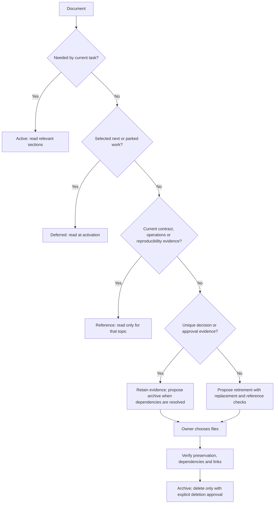

# Documentation in play

**Last reviewed:** 2026-10-15

This is a reading index, not another task board. Start with repository instructions
and the current/next boards for your area. Open additional documents only when the
task matches a row below. Files outside this index are retained material, not
default reading; use targeted lookup when the task explicitly needs them.

| State | Documents | Read when |
| --- | --- | --- |
| Current | [Backend current](work_current_phase.md), [frontend current](frontend/work_current_phase.md) | Starting work in that area; these own task scope, gates and concise evidence. |
| Next | [Backend next](next_phase.md), [frontend next](frontend/next_phase.md) | Reviewing the next three candidates; these own priority and dependencies. |
| Parked | [Task overview](task_overview.md) | Prioritizing requests beyond the next three or resolving its pending approvals. |
| Active design | [PDF experiment design](rag_pdf_experiment_design.md) | Working on the extraction experiment or its approved design boundary. |
| Retained design | [Stage C ingestion design](rag_stage_c_ingestion_design.md) | Working on the G2-approved RAG-C-01 local selector, publication identity or isolated indexed comparison. |
| Roadmap | [RAG adoption plan](RAG_ANYTHING_ADOPTION_PLAN.md) | Selecting an adoption stage; read the selected stage's sections. |
| Contract | [Frontend API contract](frontend_architecture.md) | Frontend work as required by its instructions, or changes to shared API behavior. |
| Reference | [Architecture](architecture.md), [PowerPoint ingestion](powerpoint_ingestion.md) | Changing the relevant runtime/ingestion behavior or its documentation. |
| Operations | [Authentication operations](auth_gateway_operations.md), [frontend integration acceptance](frontend/integration_test_plan.md) | Planning or performing explicitly authorized rollout/acceptance. |
| Retained design | [Account preferences](account_preferences_api_design.md), [authentication](auth_session_logout_design.md), [document catalog](recent_document_metadata_api_design.md) | Reviewing design rationale or changing that feature; the API contract owns implemented wire behavior. |
| Parked design | [Azure deployment](AZURE_DEPLOYMENT_PLAN.md) | Activating the parked office/Azure work; validate old assumptions before reuse. |
| Coordination | [Handoff rules](agent_handoff/README.md) and the relevant direction/decision file | The task depends on or changes the other team's contract. |
| History | [Completed phases](complete_phases.md) | Phase synchronization, approved closure, or a specific historical question. |
| Experiment evidence | [Stage C indexed comparison](../evaluation/pdf_parsers/corpus/STAGE_C_RESULTS.md), [Fidelity follow-up](../evaluation/pdf_parsers/corpus/NORMALIZATION_FIDELITY_REVIEW.md), [case scorecard](../evaluation/pdf_parsers/corpus/EXTRACTION_SCORECARD.md), [corpus entry point](../evaluation/pdf_parsers/corpus/README.md), [PDFium comparison](../evaluation/pdf_parsers/corpus/PDFIUM_COMPARISON.md), [runner protocol](../evaluation/pdf_parsers/README.md) | Corpus/scoring/parser work. Do not recursively read worksheets, previews, drafts or results. Follow only evidence needed for the current issue. |

## Keep plans small during development

- Current board: one phase, scope/decision, task rows and links to detailed
  evidence. Aim for one screen of overview; avoid copying reports into the board.
- Next board: at most three candidates, one sentence for objective and dependency.
- Parked work: one row per request. Expand a plan when it is selected at intake.
- Create a separate design only when a structural decision needs detail beyond
  the current task row. Once delivered, publish lasting behavior in its contract
  or operations guide and mark the design retained rather than active.
- At task completion, update this index only if a document's role changes. At
  approved phase closure, retain the concise outcome/commit/evidence pointers in
  the sole ledger and clear the closed board as repository instructions require.
  Include the exact proposed archive files in the closure request so the owner
  can approve closure and document retirement together explicitly.

## When a document leaves play

Completion or age alone does not prove a document can be removed. Before
retirement, identify its replacement, unresolved dependencies and unique evidence.
Archiving preserves history while excluding it from routine discovery. Existing
archive content stays excluded under repository instructions.

## Hashes and repeat sweeps

Git commits identify delivery history; an index state identifies relevance.
For repeated sweeps, keep a compact cache outside the repository: path, SHA-256,
purpose, dependencies, last decision and unresolved question. Reuse a discovery
summary only when its file hash and relevant dependencies still match. A changed
task/state requires reassessment even if bytes are unchanged. Hashes never prove
obsolescence or replace reading relevant sections during implementation.
Do not maintain a second tracked hash catalogue for ordinary Markdown files.
Frozen experiment hashes remain part of their reproducibility protocol.
